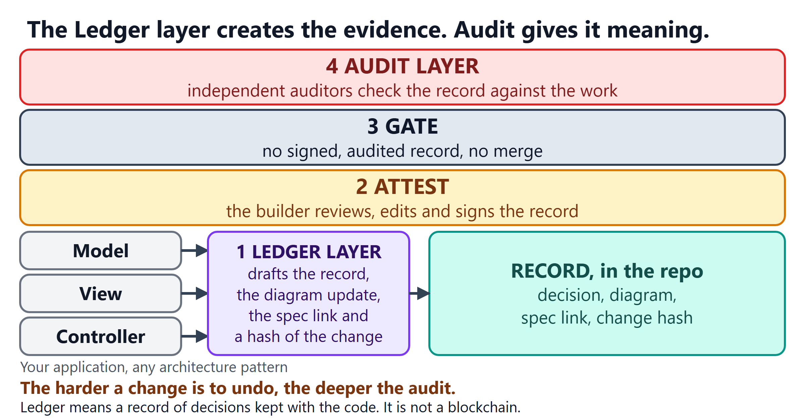
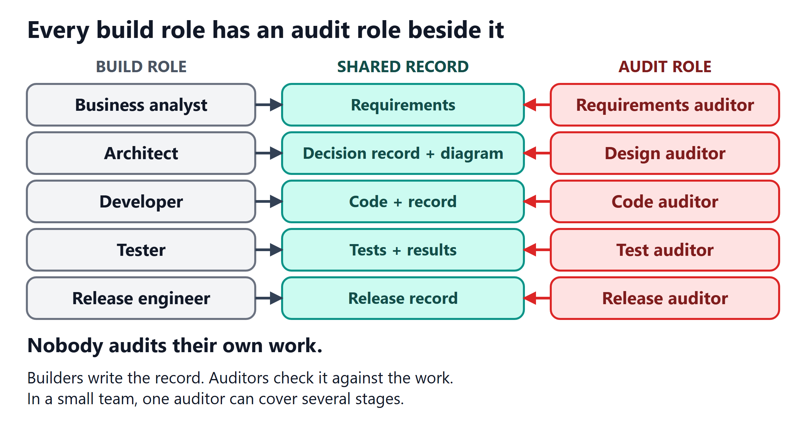
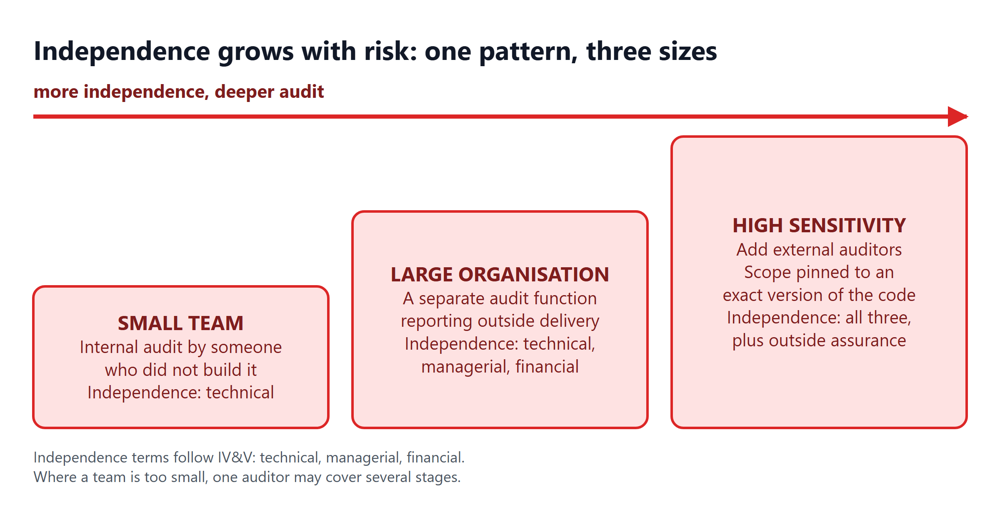
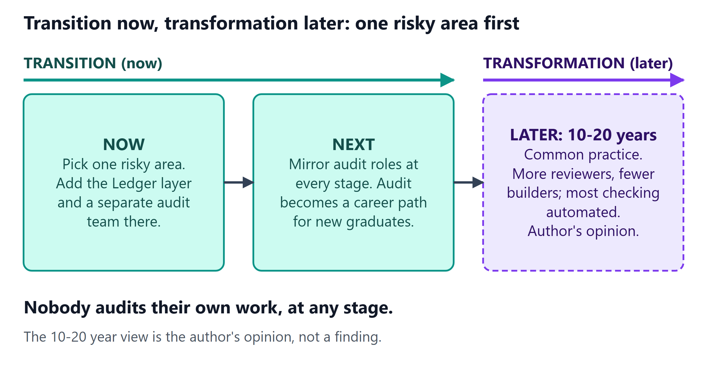

# The Ledger layer and the audit layer

A design pattern for comprehension debt. Status: **v0.1, a proposal** (see [SPEC.md](SPEC.md)).



> **The Ledger layer creates the evidence. Audit gives it meaning.**
>
> "Ledger" here means a record of decisions kept with the code. It is not a blockchain.

Article: link added on publication.

> A personal project, made on my own time. Views are my own and do not describe or represent any employer.

## The problem

Software is being built faster than people can understand it. Addy Osmani calls the gap
**comprehension debt**: the distance between how much code exists and how much of it any human
genuinely understands ([source](https://addyosmani.com/blog/comprehension-debt/)). Margaret-Anne
Storey describes the same risk as cognitive debt (in people) and intent debt (missing rationale in
artifacts) ([source](https://arxiv.org/abs/2603.22106)).

Writing the reasoning down helps, but it does not close the gap on its own:

- **A record with no audit** becomes paperwork that people sign unread.
- **An audit with no record** leaves auditors rebuilding the reasoning from the code, which is the debt itself.

## The pattern: four levels

```
4. AUDIT LAYER    Independent auditors check the record against the work.
                  A mirror audit role per stage (requirements, design, code,
                  test, release), scaled by risk: internal, then a separate
                  function, then external.
3. GATE           The pipeline refuses a change without a signed, audited record.
2. ATTEST         The builder reviews and signs what the Ledger drafted.
                  The builder owns the content.
1. LEDGER LAYER   Runs beside Model / View / Controller (or any pattern).
                  For every change it drafts the decision record, the diagram
                  update, the spec link, and a hash of the change.
```

The rules, in short (the normative version is [SPEC.md](SPEC.md)):

1. Every change that needs a record has one, kept in the repository next to the code it covers.
2. A named human, the builder, attests the record. Builders use tools to build fast, but they own what they sign. (In the demo a "signature" is a typed name. A real setup ties attestation and audit to verified accounts: pull request approvals, branch protection, signed commits.)
3. A different person audits it. **Nobody audits their own work.**
4. The record carries a hash of the change, so the code and the record cannot drift apart unnoticed.
5. The gate refuses a change that has no signed, audited record that still matches the code.

### The three audit checks

| Check | What it asks | How |
|---|---|---|
| **Consistency** | Does the code match the signed record? | Automatic, from the pinned change hash |
| **Comprehension** | Can the builder explain the change? | The auditor asks for an "explain-back" in the builder's own words; recorded; required for hard and irreversible changes, optional (or sampled) for easy ones |
| **Behaviour** | Does the system hold up? | Independent stress and adversarial testing |

A record that the builder signed with **zero edits** to the drafted text is flagged.

**What auditors look at:** code quality and the damage a change could do; whether the requirements and the business
need are met; efficiency; and whether someone who did not write it can explain it. The records also pay off later:
when something breaks, the decision, its alternatives and its audit are written down next to the code, which helps
debugging and reverse engineering.

### Irreversibility sets audit depth

The harder a change is to undo, the deeper the audit. A policy file maps paths to levels, and levels to
required checks. This is the default policy ([SPEC.md](SPEC.md) section 7.3), and the demo implements it:

| Reversibility | Required checks |
|---|---|
| Easy to undo | Consistency |
| Hard to undo | Consistency, explain-back |
| Cannot be undone | Consistency, explain-back, independent stress test |

## What this means for engineers

*This section is the author's view, not a finding. There are no statistics here on purpose.*

- **Fewer builders, more reviewers and auditors.** If tools keep making building faster, the scarce
  skill shifts to checking. I expect a new wave of audit work. Audit will itself be tool-assisted, but a
  person signs, and the tools should be independent of the ones the builders used.
- **A new responsibilities chart.** The fixed roles of today (analyst, developer, tester, release
  engineer) each get an audit role beside them. Over a career, engineers can rotate between building,
  specifying and auditing. They never audit their own work.
- **Audit becomes an entry path for graduates.** Reading and challenging real systems is a good way to
  learn them.
- **The 10 to 20 year view is my opinion.** I think this becomes common practice across software. High-stakes
  systems should adopt it now.







## Try it

The reference implementation is a small fictional demo (a bakery ordering app). It is an **illustration** of
the idea, not a product. Names are typed text, so an attestation proves nothing about who really signed
(see [SPEC.md](SPEC.md) section 4.4). The gate reads its policy from the base branch, so a pull request cannot
switch it off.

```bash
cd reference-implementation
pip install -e ".[test]"
python walkthrough.py        # a 60-second scripted walkthrough
pytest                       # 14 tests
```

Use the gate in a pull request workflow. The action is [action.yml](action.yml) (the `v0.1` tag exists
once the first release is made):

```yaml
on: pull_request
jobs:
  ledger-gate:
    runs-on: ubuntu-latest
    steps:
      - uses: actions/checkout@v5
      - uses: i-asimkhan/ledger-layer-pattern@v0.1
```

Sample output (from the walkthrough): [failing](docs/demo-output/failing.txt),
[passing](docs/demo-output/passing.txt), [full transcript](docs/demo-output/walkthrough.txt).

## What is in this repository

| Path | What it holds |
|---|---|
| [SPEC.md](SPEC.md) | The pattern as a short standard (MUST / SHOULD / MAY), v0.1 |
| [FAQ.md](FAQ.md) | "Isn't this just ADRs?", "Isn't this code review?", "Won't it slow us down?", and more |
| [COMPARISON.md](COMPARISON.md) | How this differs from ADRs, code review, change-management controls, IV&V and the intent ledger |
| [diagrams/](diagrams/) | draw.io sources, with PNG and SVG exports |
| [templates/](templates/) | A decision record template and an audit note template |
| [examples/](examples/) | Three fictional records |
| [reference-implementation/](reference-implementation/) | The `ledger` CLI, the gate, the demo app and the tests |
| [action.yml](action.yml) | The gate as a reusable GitHub Action |
| [SOURCES.md](SOURCES.md) | References, with links |

## Help shape this pattern

This is an open proposal, and I would like input from across the industry. It is early, and it is probably wrong in
places. If you build, test, audit, review, manage or secure software, I would like to hear where it breaks.

Questions I would like answered:

1. **Where would this break in your organisation?** What would your team skip first?
2. **How would you tell a real audit from a rubber stamp?** What evidence of understanding is enough?
3. **What should audit depth depend on?** I use "how hard is it to undo". What else matters?
4. **Who audits the auditors** at your size: a small team, a large organisation, high-sensitivity work?
5. **What already does part of this?** Practices, standards or tools I should credit or compare against.
6. **What would make the Ledger layer cheap to adopt** in the tools you already use?

How to join, once the repository is public: use **GitHub Discussions** for open questions and ideas, and
**issues** for specific proposals, spec changes and bugs (templates are provided). Pull requests to the spec,
the FAQ and the comparison table are welcome.

## Credits and prior art

This pattern adapts existing practice and builds on other people's work: Addy Osmani ("Comprehension
Debt", "The Intent Debt"), Margaret-Anne Storey (the cognitive and intent debt framework), the IIA Three
Lines Model, NASA Independent Verification and Validation and IEEE's independence parameters, and
Michael Nygard's architecture decision records as described by Martin Fowler. Links are in
[SOURCES.md](SOURCES.md).

## Licence

Code (the reference implementation and the action): [MIT](LICENSE).
Text and diagrams: [CC BY 4.0](https://creativecommons.org/licenses/by/4.0/).

## Cite this

See [CITATION.cff](CITATION.cff).

## Author

Asim Khan. A personal project, made on my own time. Views are my own and do not describe or represent any employer.
